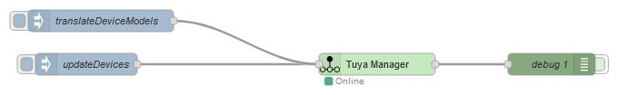
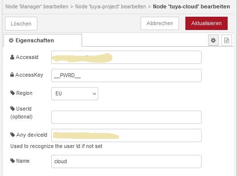
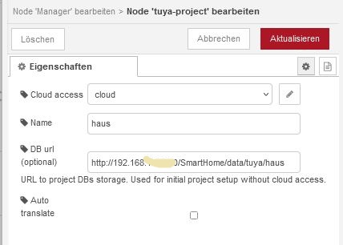
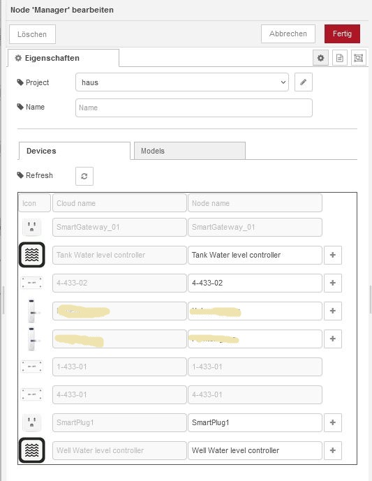
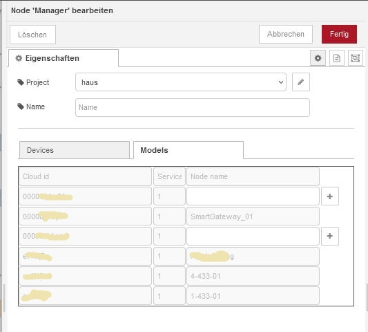

# node-red-contrib-tuya-devices
Support for Tuya devices in SmartHome projects using [Node-RED](https://nodered.org/).  
The goal of the project is to allow using local devices supports Tuya in Node-Red

## Getting Started

Prerequisites: [Node-RED](https://nodered.org) installation. For details see [here](https://nodered.org/docs/getting-started/installation).

Install via npm

```shell
$ cd ~/.node-red
$ npm install node-red-contrib-tuya-devices
```
then restart node-red

The Tuya devices are represented by config Nodes (single Node per device). The flow Nodes references a device node and can exists multiple times in different flows. It can be defined a project object to group and control all Tuya devices in the local network. The IP addresses of the devices will be detect automaticaly. If configured a cloud access the device capabilities will be downloded and cached localy.

## First steps
Insert Tuya manager node. 
In the manager config form:  
- Add new tuya-project. 
  In the project config form:  
  - set the name for the project
  - Add new tuya-cloud. 
    In the cloud config form you can select the application type as "smart" to use own Tuya appliction created in Tuya IoT. The other option is to use an account in an own or existing bisiness application.
    Config for smart application:
    - set the AccessID, AccessKey and Any deviceId (needed to recognise the userId and all devices mapped to the same user account)
    - optional can be set the Tuya cloud userId if known and a name for the config node
  - Optional can be added new MQTT broker. It will be used for all Tuya devices in the project. The device data can be accessed in the broker with MQTT topic "tuya/(deviceId)/tele/(dp)"

## Usage
If the cloud configuration is correct and the manager node has received at least once a message with topic 'updateDevices' all mapped devices will be listed in the config. The device capabilities will be cached localy. With the plus button can be added a config node for every local device. This config nodes contains all setting nedded to use the device localy and can be selected in the configuration of the Tuya device nodes. 
The device nodes can be easy connected to dashboard ui nodes (see example below). For this the single DP must be selected or a topic must be used to select a rigth DP, e.g by using of switch node. If device capabilites exists in local cache (e.g. after once successfully loaded from cloud) the device commands can be requestet by message usung topic 'dispatchCommands' (as in examle). A whole data model for the device can be requested by message with topic 'getDataModel'. 

The Tuya protocol version of a local device (Advanced tab) can be left on `auto`: the first answer of the device verifies the version, it is stored in the local cache and shown as verified in the config dialog. To force a new detection, e.g. after a firmware update, select another version or `auto` and deploy, or send a message with topic `resetProtocolVersion` to a device node.

## Device monitor
The project can monitor its local devices and report when a device is degraded or has failed. The monitor is off by default; enable it in the Monitoring tab of the project node, or per device in the Monitoring tab of the local device node. Only devices used by a device node are monitored. A change of the health is sent on the output of the manager node with topic `deviceHealth`, including a diagnosis of the probable cause. Optional self-healing rebuilds the connection, searches the device in the network and can switch its power off and on by a power switch device; each action is reported with topic `deviceHealing`. For details see [Device monitor](./doc/monitoring.md).

## Alarm hub: known faults
For an alarm hub (category `mal`), an alarm whose message (DP 26) matches the fault pattern (default `batter`, e.g. a low battery of a sensor) is a known fault, not an intrusion. Each fault is kept as an open point in the hub context and reported as new only the first time. The device node sends `alarmEvent` (`kind` `intrusion` or `fault`, `sensor`, `message`, for faults also `first` and `count`), `openPoints` and, if an automatic acknowledge was not confirmed, `faultAckFailed`; the commands `getOpenPoints` and `resetOpenPoints` read and clear the open points. Known faults can be acknowledged at the hub automatically, an intrusion never. The settings are in the Extension tab of the local device node, shown only for devices with this extension.

## Examples
- [Step by step with pictures](./doc/step_by_step.md)
- [Tuya power device flow examle](./img/power_dev.json)
- [Tuya themperature and humidity sensor device flow examle](./img/th_sensor.json)
- [Tuya multifunctional alarm device flow examle](./img/alarm.json) for control and configuration

## [Changelog](./CHANGELOG.md)

## Disclaimer
The software is provided as-is under the MIT license. The author cannot be held responsible for any unintended behaviours.

## Thanks
If you like our ideas and want to support further development, you can donate here:  
[](https://paypal.me/tasmotas)
[](https://www.buymeacoffee.com/smarthomenodes)  
Please understand that requests from those who support us will be given priority

## Screenshots
 
 
 
 
 
